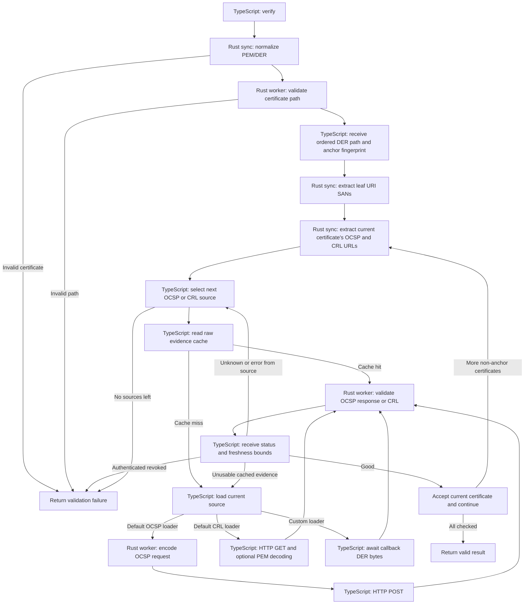

# Verification flow

The public entry point is `createTrustValidator(options).verify(input)`.
TypeScript coordinates certificate trust, evidence retrieval, cache storage and
failure handling. Rust parses certificates and authenticates paths and
revocation evidence. All native calls pass through [src/native.ts](../src/native.ts).

## TypeScript modules

| Module | Responsibility |
| --- | --- |
| `index.ts` | Public exports. |
| `validation-types.ts` | Validator options and public result types. |
| `trust-validator.ts` | Validator initialization and the `verify` sequence. |
| `certificates.ts` | Certificate input normalization, path validation and URI SANs. |
| `certificate-revocation.ts` | One certificate's OCSP-first source selection and CRL fallback. |
| `revocation-checker.ts` | One source's cache lookup, evidence revalidation, loading and diagnostics. |
| `revocation-validation.ts` | Native CRL/OCSP adapters and millisecond-to-`Date` conversion. |
| `cache.ts` | Memory cache and raw revocation evidence storage, expiration and eviction. |
| `http-loaders.ts` | HTTP transport, response limits and default CRL/OCSP loaders. |
| `http-policy.ts` | URL restrictions, address filtering and DNS lookup tied to the connection. |
| `diagnostics.ts` | Diagnostic types and callback isolation. |
| `native.ts` | Typed native binding and synchronous certificate error translation. |

## Initialization

`createTrustValidator` synchronously normalizes configured trust anchors through
Rust's `certificateDer`. It receives independent DER snapshots, so subsequent
changes to the caller's input buffers cannot change the configured trust store.
Malformed anchor configuration throws before a validator is returned.

It then configures loaders, cache handling and diagnostic reporting. Initialization
does not perform path validation or fetch revocation evidence.

## One call to `verify`

1. `certificates.ts` checks the validation date and normalizes anchors and input
   certificates. Each `certificateDer` call enters Rust synchronously and returns
   one validated DER snapshot. Unexpected trailing DER bytes are rejected.
2. `validateCertificatePath` dispatches Rust path validation and awaits its
   result. Rust returns an ordered leaf-first path, the selected anchor index
   and its SHA-256 fingerprint. A failed path returns a failure before any
   revocation lookup.
3. The leaf URI SAN helper normalizes the leaf DER through Rust and then makes
   a separate synchronous Rust call to extract URI strings.
4. For each leaf/intermediate certificate, Rust extracts OCSP AIA and CRL
   distribution-point URLs. The configured trust anchor is not queried for
   revocation.
5. TypeScript tries OCSP sources in order, then CRL sources. For each source,
   it reads the raw evidence cache. A cache hit still goes through Rust
   authentication and freshness checks; unusable cached evidence is discarded
   and reloaded.
6. On an OCSP cache miss, the default loader asks Rust to build the unsigned DER
   request, receives its bytes, and sends the HTTP POST in TypeScript. Custom
   OCSP loaders receive certificate and issuer DER and control retrieval
   themselves. The default CRL loader uses TypeScript HTTP GET and optional PEM
   decoding; custom CRL loaders return DER bytes from their chosen source.
7. Retrieved response/CRL bytes enter Rust for validation. The result returns
   to TypeScript as `good`, `revoked` or `unknown`, with freshness timestamps
   or a failure code/message. The adapter turns successful timestamps into
   JavaScript `Date` objects. Only authenticated `good`/`revoked` evidence is
   cached; TTL is bounded by both `nextUpdate` and `maxCacheAgeMs`.
8. A usable `good` result advances to the next certificate. Authenticated
   `revoked` terminates verification immediately. `unknown` or a source error
   tries the next source; exhausting sources fails closed. All non-anchor
   certificates must have established `good` status before success is returned.

When no explicit `checkDate` is supplied, revocation validation reads the clock
after retrieval, rather than validating newly produced evidence against a stale
time captured before the request.

## Rust entry and exit points

Names below are the generated JavaScript exports of the Rust addon.

| Native call | TypeScript caller | Execution | Returned value |
| --- | --- | --- | --- |
| `certificateDer` | `certificates.ts` | Synchronous | Independent certificate DER bytes. |
| `validateCertificatePath` | `certificates.ts` | Worker task | DER path, anchor index and fingerprint. |
| `getUriSubjectAlternativeNames` | `certificates.ts` | Synchronous | URI strings. |
| `getRevocationEndpoints` | `certificate-revocation.ts` via `native.ts` | Synchronous | OCSP and CRL URLs. |
| `createOcspRequest` | `http-loaders.ts` | Worker task | OCSP request DER bytes. |
| `validateOcsp` | `revocation-validation.ts` | Worker task | Status, freshness bounds or failure details. |
| `validateCrl` | `revocation-validation.ts` | Worker task | Status, freshness bounds or failure details. |

Synchronous Rust functions run on the JavaScript thread. Worker APIs copy their
input bytes before dispatch, run `Task::compute` in libuv's worker pool and
complete their Promise through `Task::resolve` on the JavaScript thread. After
each result is delivered, TypeScript resumes the next stage. HTTP, cache I/O,
callbacks, fallback decisions and the final public result remain in TypeScript.
