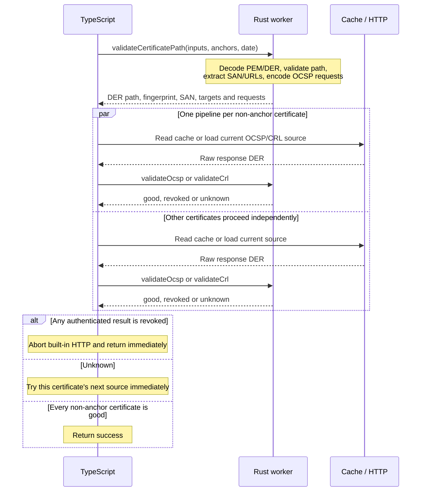

# Verification flow

The public entry point is `createTrustValidator(options).verify(input)`. All
native calls pass through [src/native.ts](../src/native.ts). Construction copies
trust-anchor input bytes and makes no native calls.

## Immediate evidence validation

1. `certificates.ts` converts string inputs to UTF-8 bytes. The path worker
   snapshots every input, decodes all candidates, builds the trusted path and
   validates its signatures, dates and constraints.
2. The same worker extracts leaf URI SANs, public key SPKI DER, SHA-256
   fingerprint, serial number and validity timestamps, plus CRL/OCSP URLs and an
   OCSP request for each non-anchor certificate. No separate metadata calls are
   needed. Leaf metadata is exposed by the public API only on successful verification.
3. TypeScript starts one source pipeline per non-anchor certificate. Pipelines
   run concurrently; sources within one certificate remain ordered OCSP first,
   then CRL.
4. Every cache hit is reauthenticated. Every cached or loaded response enters
   its existing `validateOcsp` or `validateCrl` worker immediately. There is no
   cross-certificate readiness barrier.
5. A current authenticated `good` result completes that certificate. `unknown`
   discards unusable cache data or advances directly to the next source.
6. A current authenticated `revoked` result wins over unknown outcomes, resolves
   `verify` immediately and aborts built-in HTTP requests. Custom loaders receive
   an `AbortSignal` and should honor it; loaders that ignore it may finish in the
   background, but cannot change the returned result.
7. Success requires `good` status for every non-anchor certificate. Exhausting
   one certificate's sources fails closed with `REVOCATION_STATUS_UNKNOWN`. The
   trust anchor itself is not queried for revocation.

Without an explicit `checkDate`, each response reads the configured clock when
it is ready for native validation. An explicit date is reused for the path and
all revocation evidence.

## Native call counts

There is one path call plus one call for every CRL/OCSP response that is actually
authenticated. For the common leaf + intermediate + root path:

| Scenario | Rust API calls per `verify` |
| --- | --- |
| First OCSP sources return good | 3: path + two OCSP responses |
| Valid cache hits for both certificates | 3: cached bytes are reauthenticated |
| CRL-only success | 3: path + two CRLs |
| Leaf OCSP is unknown and its CRL is good | 4: path + three responses |
| A cache entry is invalid and reloaded | One additional call for its replacement |
| Path rejected before evidence retrieval | 1 |

Independent evidence workers may run concurrently in libuv's worker pool.

## Modules

| Module | Responsibility |
| --- | --- |
| `trust-validator.ts` | Parallel pipelines, revoked early completion and final result. |
| `certificates.ts` | Input bytes, prepared-path adapter and certificate helpers. |
| `certificate-revocation.ts` | Per-certificate source order and fallback. |
| `revocation-checker.ts` | Per-source cache, load and immediate validation lifecycle. |
| `revocation-validation.ts` | CRL/OCSP native calls and JavaScript result adapters. |
| `cache.ts` | Raw evidence storage, TTL and eviction. |
| `http-loaders.ts` / `http-policy.ts` | Abortable HTTP transport and destination restrictions. |
| `native.ts` | Typed addon binding and synchronous error translation. |
| `validation-types.ts` / `diagnostics.ts` | Public contracts and callback isolation. |

Standalone URI extraction uses one synchronous
`getUriSubjectAlternativeNames` call for PEM or DER. CPU-heavy path and evidence
validation run in libuv's worker pool; HTTP, cache I/O and user callbacks remain
in TypeScript.

The Rust source is organized by responsibility:

| Module under `native/src/` | Responsibility |
| --- | --- |
| `lib.rs` | Certificate decoding, metadata exports and shared status types. |
| `certificate_path.rs` | Path validation and revocation target preparation. |
| `leaf_certificate.rs` | Leaf metadata extraction, generated result type and certificate fingerprints. |
| `names.rs` | Shared distinguished-name matching and its unit tests. |
| `crl.rs` | CRL result types and native worker bindings. |
| `crl/validation.rs` | CRL authorization, extensions, dates, signatures and status. |
| `ocsp.rs` | OCSP result types and native worker bindings. |
| `ocsp/request.rs` | OCSP request DER encoding. |
| `ocsp/identity.rs` | CertID hashes and direct-issuer responder matching. |
| `ocsp/signature.rs` | Supported signature parameters, including RSA-PSS. |
| `ocsp/response.rs` | Response decoding, freshness, authentication and status. |
